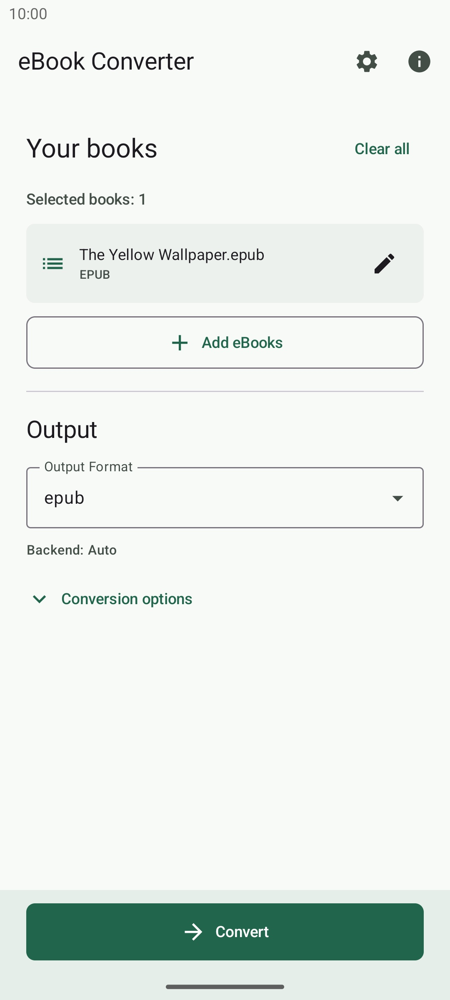
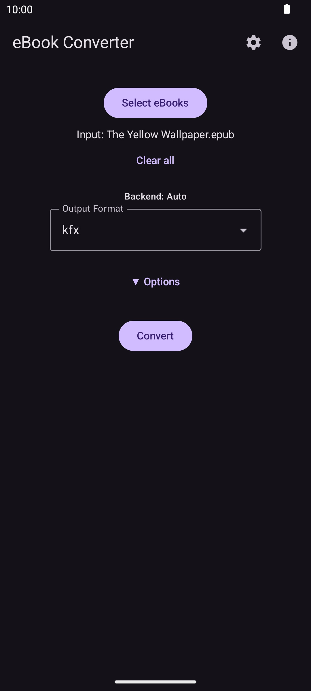
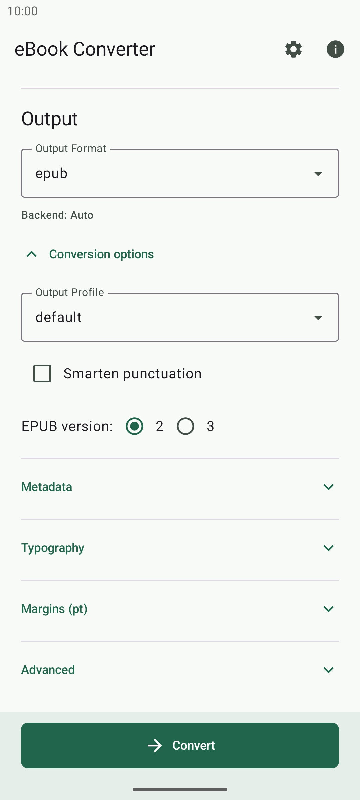
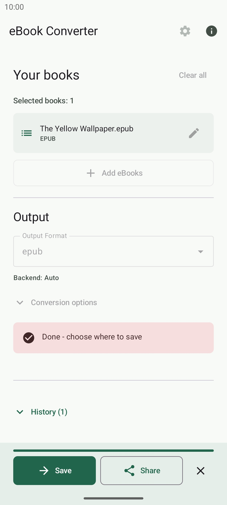
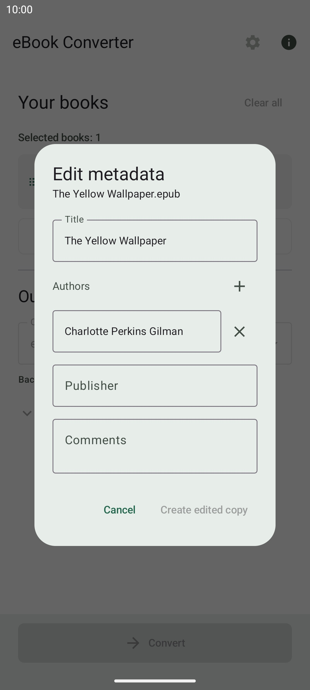
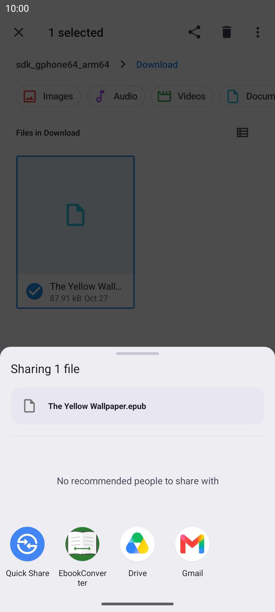
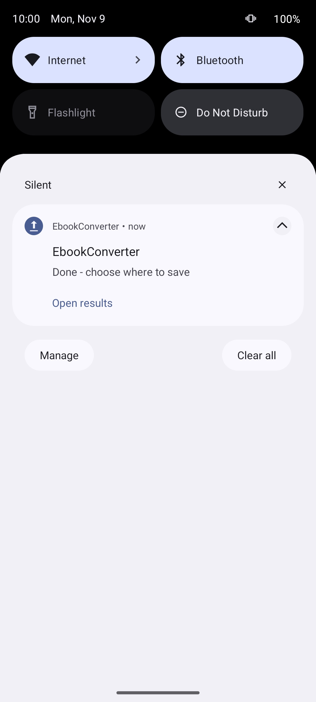
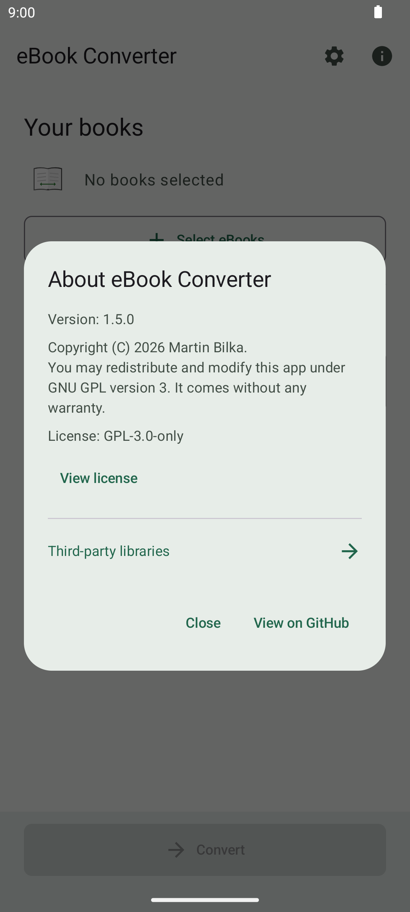
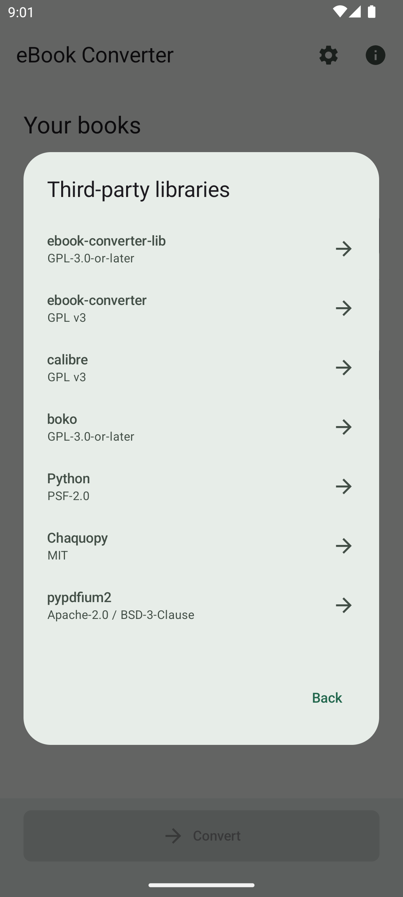
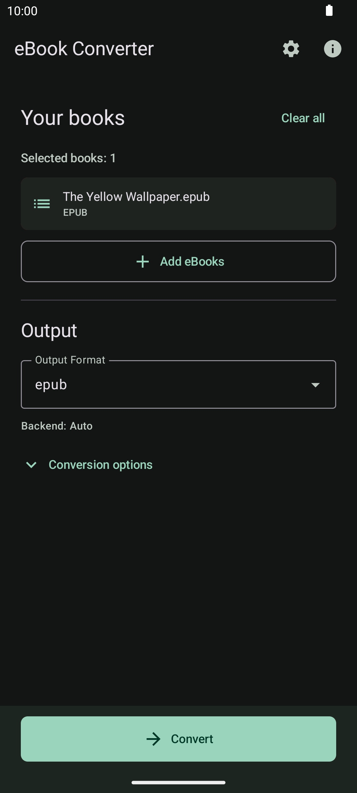

# eConverter

  

Android app for converting e-books individually or in batches with Calibre and boko.

## Usage

1. **Select eBooks**, then choose an **Output Format**. **Add eBooks** extends the queue.
2. Optionally open **Conversion options** for Metadata, Typography, Margins, or
   Advanced settings (extra arguments and text removal). Closing a group keeps its values.
3. Tap **Convert**, then **Save** to a folder or **Share** the results.

You can also share one or more e-book files from another app to **eConverter**.
Supported files are added to the queue without duplicates; finish or cancel any
active operation or pending save before sharing more books. Text links are not
imported. Selection controls are disabled while files are loading.

Conversion continues when you press Home or switch apps. Its notification shows
batch progress and **Cancel**. After completion, **Open results** opens the app's
**Save** and **Share** controls.
Android 13+ asks for notification permission when converting. Denying permission
does not prevent conversion, but hides progress and completion notifications.
Keep the app in Recents: finishing its activity, force-stopping it, or process
death can interrupt conversion; interrupted jobs cannot be resumed.

Each EPUB, AZW3, or MOBI has **Edit metadata**, including in a multi-book queue.
Choose **Create edited copy**, then **Save** or **Share**; originals and the queue
stay unchanged. Cancelling an update returns to the editor with the draft retained;
failed updates also keep the draft for retry.
Metadata reads and updates exceeding 64 KiB of serialized data are rejected,
not truncated.

Shared output files are retained for one hour, including across app restarts,
then become eligible for cleanup.

**Cancel** discards all temporary outputs from the current batch, including completed
books; originals are unchanged.

Swipe a selected book left or right to remove it from the queue. **Clear all**
deselects all books. **History** restores a previous selection, output format, and
backend for the current app session.

## Formats and Backends

**Input (Auto):** epub, mobi, azw3, docx, odt, fb2, html, htmlz, lrf, pdb, rtf, txt, md, markdown, pdf, kfx

**Output (Auto):** epub, kfx, mobi, azw3, docx, fb2, htmlz, lrf, md, txt, txtz

> PDF input must contain text. Scanned PDFs require OCR, which is unavailable on Android.

Choose a backend in **Settings**; the choice is remembered.

| Backend | Formats and Options |
| --- | --- |
| Auto (default) | All formats above. Combines Calibre and boko through intermediate EPUBs when needed; Calibre options apply. |
| Calibre | Auto's formats except KFX input and KFX/Markdown output. |
| boko | Input: epub, kfx, azw3, mobi. Output: epub, kfx, azw3, md. Native conversion; Calibre options are hidden but retained. |

Switching backend keeps selected books. Incompatible books block conversion until
cleared or a compatible backend is chosen. Unsupported output choices reset to EPUB.

## Build

Requires JDK 17+, Android SDK platform 37, and Python 3.11 (`python3.11` on PATH,
or `CHAQUOPY_BUILD_PYTHON` set to its absolute path). Android Studio is optional.

Install Android NDK r30 with `sdkmanager "ndk;30.0.16248370"` to strip native
library symbols; without it, Gradle packages the libraries unchanged.

| Command | Purpose |
| --- | --- |
| `./gradlew assembleDebug` | Build debug APKs for every ABI flavor (`armeabi-v7a`, `x86_64`, `arm64-v8a`, `universal`). |
| `./gradlew installUniversalDebug` | Install on a connected device or emulator. |
| `./gradlew check` | Run lint, formatting checks, and unit tests. |
| `./gradlew :app:connectedUniversalDebugAndroidTest` | Run device/emulator tests. |

Engine versions are pinned in [gradle.properties](gradle.properties) by
`EBOOK_CONVERTER_LIB_VERSION`, `PYPDFIUM2_VERSION`, and `BOKO_ANDROID_VERSION`.
The PDFium version must match ebook-converter-lib's pin; its x86_64 wheel comes
from the lib's `pypdfium2-<version>-android` release rather than PyPI.

For F-Droid release work, initialize the pinned [CPython submodule](.gitmodules)
with `git submodule update --init --depth 1 cpython`. Normal builds use installed
Python. Build the host interpreter with
`./configure --with-ensurepip=no --disable-test-modules` to skip test-only
extensions, then verify `ssl`, `zlib`, `bz2`, `lzma`, and `ctypes` imports.
See [CODEBASE_MAP.md](CODEBASE_MAP.md) for the architecture.

### CI Debug APKs

Run **Debug APK** manually from **Actions**, selecting the branch to build
(including feature branches with open PRs). This workflow builds debug APKs
without running tests or requiring deployment approval.
Download `debug-apks-*` from the run's **Artifacts** (GitHub sign-in required).
Artifacts expire after 14 days; no release is created.

## Source Code and Licenses

eConverter is licensed under [GPL-3.0-only](LICENSE). **About** provides legal
notices and offline GPL, Python, and Chaquopy licenses. Other dependency
notices ship in the APK; library credits also link to upstream licenses.
Additional notices in `assets/licenses/` cover CPython 3.11.17's incorporated
software, libffi 3.4.4, bzip2 1.0.8, FreeType, and odfpy 1.4.1. Runtime
dependency versions and build patches are pinned in
[Chaquopy's runtime recipe](https://github.com/chaquo/chaquopy/blob/17.1.0/target/python/build.sh).

Use the **Source code** archive or tag matching your release, not the default
branch. See [Build](#build) for app build instructions and the table below for
dependency sources and native build recipes. The app archive alone does not
contain external native libraries' source.

| Component | Source and Build Recipes for This Revision |
| --- | --- |
| ebook-converter-lib 1.6.1 | [Tagged source, packaging, and dependency pins](https://github.com/bilec/ebook-converter-lib/tree/v1.6.1). |
| boko-android 0.1.4 | [Tagged Kotlin/JNI/Rust source and Android build instructions](https://github.com/bilec/boko-bindings/tree/v0.1.4); `Cargo.toml` pins [boko's exact source revision](https://github.com/bilec/boko/tree/23fcdcedad99fc4e2fa916c904df6d02fee41fcc), and `Cargo.lock` records Rust dependencies. |
| Python 3.11.17 / Chaquopy 17.1.0 | [CPython source](https://github.com/python/cpython/tree/v3.11.17), [runtime build scripts and patches](https://github.com/chaquo/chaquopy/tree/17.1.0/target), and [native package recipes](https://github.com/chaquo/chaquopy/tree/17.1.0/server/pypi/packages). |
| pypdfium2 5.14.0 | [Tagged source and setup scripts](https://github.com/pypdfium2-team/pypdfium2/tree/5.14.0); [Android x86_64 repackaging recipe](https://github.com/bilec/ebook-converter-lib/blob/v1.6.1/.github/workflows/android-wheels.yml). |
| PDFium 156.0.8076.0 | [PDFium source and dependency revisions](https://pdfium.googlesource.com/pdfium/+/refs/heads/chromium/8076/); [binary build scripts](https://github.com/bblanchon/pdfium-binaries/tree/chromium/8076). |

When redistributing APKs, retain applicable license and copyright notices
and provide access to matching Corresponding Source, including required
dependency sources and build scripts, under GPLv3. Keep source directions
beside binary downloads and update this table and bundled notices when
dependencies change. The `cpython` submodule is the F-Droid host interpreter,
not the embedded Android runtime.

ebook-converter-lib packages [ebook-converter](https://github.com/gryf/ebook-converter).
The Android boko bindings use [boko](https://github.com/zacharydenton/boko)
by Zachary Denton.

The ebook-converter-lib package's KF8/AZW3 writer (`ebook_converter.ebooks.mobi.writer8`)
and HTML export templates (`ebook_converter/data/html_export_default*`) are ported
from [calibre](https://github.com/kovidgoyal/calibre) (GPL v3, © Kovid Goyal).
The templates were adapted from Mustache to templite syntax.

## Translations

Conversion engine diagnostics may remain untranslated.

Community translations are welcome! To add a new language:

1. Copy `app/src/main/res/values/strings.xml` to `app/src/main/res/values-<lang>/strings.xml` (e.g. `values-de/strings.xml`).
2. Add your language tag to `app/src/main/res/xml/locales_config.xml`.
3. Submit a pull request with your changes.

To request a language or share translations without a pull request, open an issue
using the [translation template](.github/ISSUE_TEMPLATE/translation.md).

## Screenshots

| Conversion | Backend Settings |
| --- | --- |
|  |  |
| **Options** | **Save and Share** |
|  |  |
| **Metadata Editor** | **Share to eConverter** |
|  |  |
| **Background Completion** | **About** |
|  |  |
| **Third-party Libraries** | **Dark Mode** |
|  |  |
