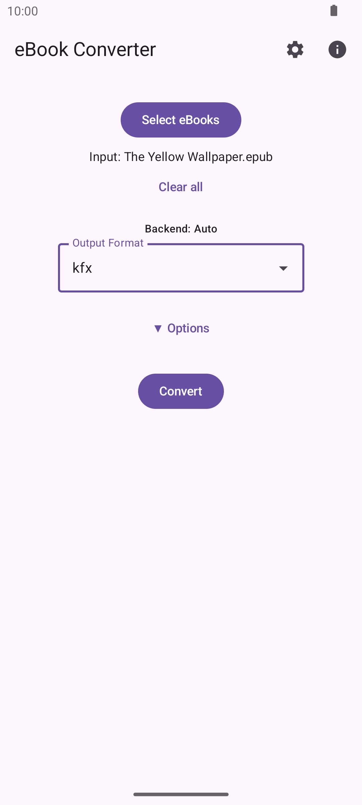
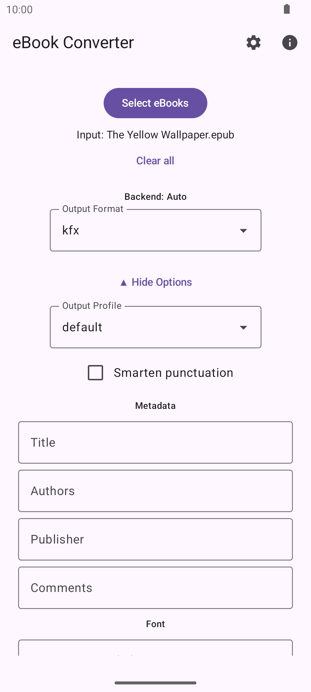

# eConverter

  

Android app for converting e-books individually or in batches with Calibre and boko.

## Usage

1. **Select eBooks**, then choose an **Output Format**. **Add eBooks** extends the queue.
2. Optionally open **Conversion options** for Metadata, Typography, Margins, or
   Advanced settings (extra arguments and text removal). Closing a group keeps its values.
3. Tap **Convert**, then **Save** to a folder or **Share** the results.

**Cancel** discards all temporary outputs from the current batch, including completed
books; originals are unchanged.

Swipe a selected book left or right to remove it from the queue. **Clear all**
deselects all books. **History** restores a previous selection, output format, and
backend for the current app session.

## Formats and Backends

**Input (Auto):** epub, mobi, azw3, docx, odt, fb2, html, htmlz, lrf, pdb, rtf, txt, md, markdown, pdf, kfx

**Output (Auto):** epub, kfx, mobi, azw3, docx, fb2, htmlz, lrf, md, txt, txtz

> PDF input must contain text. Scanned PDFs require OCR, which is unavailable on Android.

Choose a backend in **Settings**; the choice is remembered.

| Backend | Formats and Options |
| --- | --- |
| Auto (default) | All formats above. Combines Calibre and boko through intermediate EPUBs when needed; Calibre options apply. |
| Calibre | Auto's formats except KFX input and KFX/Markdown output. |
| boko | Input: epub, kfx, azw3, mobi. Output: epub, kfx, azw3, md. Native conversion; Calibre options are hidden but retained. |

Switching backend keeps selected books. Incompatible books block conversion until
cleared or a compatible backend is chosen. Unsupported output choices reset to EPUB.

## Build

Requires JDK 17+, Android SDK platform 37, and Python 3.11 (`python3.11` on PATH,
or `CHAQUOPY_BUILD_PYTHON` set to its absolute path). Android Studio is optional.

| Command | Purpose |
| --- | --- |
| `./gradlew assembleDebug` | Build the debug APK. |
| `./gradlew installDebug` | Install on a connected device or emulator. |

Engine versions are pinned in [gradle.properties](gradle.properties) by
`EBOOK_CONVERTER_LIB_VERSION`, `PYPDFIUM2_VERSION`, and `BOKO_ANDROID_VERSION`.
The PDFium version must match ebook-converter-lib's pin; its x86_64 wheel comes
from the lib's `pypdfium2-<version>-android` release rather than PyPI.

For F-Droid release work, initialize the pinned [CPython submodule](.gitmodules)
with `git submodule update --init cpython`. Normal builds use installed Python.
See [CODEBASE_MAP.md](CODEBASE_MAP.md) for the architecture.

## Credits

- [ebook-converter](https://github.com/gryf/ebook-converter), packaged as
  [ebook-converter-lib](https://github.com/bilec/ebook-converter-lib).
- [boko](https://github.com/zacharydenton/boko) by Zachary Denton, via our Android bindings.
- [Python](https://www.python.org/) and [Chaquopy](https://chaquo.com/chaquopy/) for the embedded runtime.
- [PDFium](https://pdfium.googlesource.com/pdfium/) and
  [pypdfium2](https://github.com/pypdfium2-team/pypdfium2) for PDF input.

The ebook-converter-lib package's KF8/AZW3 writer (`ebook_converter.ebooks.mobi.writer8`)
and HTML export templates (`ebook_converter/data/html_export_default*`) are ported
from [calibre](https://github.com/kovidgoyal/calibre) (GPL v3, © Kovid Goyal).
The templates were adapted from Mustache to templite syntax.

## Translations

Conversion engine diagnostics may remain untranslated.

Community translations are welcome! To add a new language:

1. Copy `app/src/main/res/values/strings.xml` to `app/src/main/res/values-<lang>/strings.xml` (e.g. `values-de/strings.xml`).
2. Add your language tag to `app/src/main/res/xml/locales_config.xml`.
3. Submit a pull request with your changes.

To request a language or share translations without a pull request, open an issue
using the [translation template](.github/ISSUE_TEMPLATE/translation.md).

## Screenshots

| Conversion | Options |
| --- | --- |
|  |  |
| Select books and choose an output format. | Adjust conversion settings and book metadata. |
